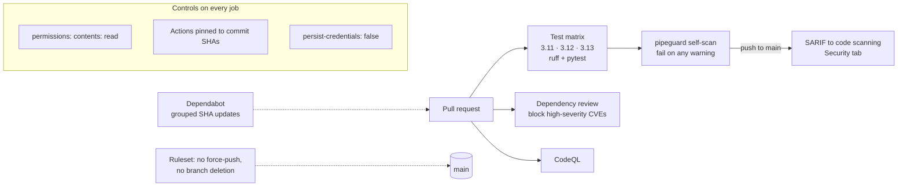

# devsecops-reference-pipelines

**Your CI pipeline holds your secrets and can push to `main`. Who reviews the pipeline?**

Reference GitHub Actions pipelines hardened against real CI/CD supply-chain attacks, and
**pipeguard**, a small static checker that finds the same problems in any repository's workflows
and reports them to GitHub code scanning. This repository runs pipeguard on itself and fails its
own build on any warning.

[](../../actions/workflows/ci.yml)


## The pipeline



## What pipeguard checks

| Rule | Severity | Finds | Fix |
|---|---|---|---|
| PG001 | error | No top-level `permissions` (jobs get the default token) | `permissions: contents: read`, widen per job |
| PG002 | error | `write-all` permissions | Grant only the scopes a job needs |
| PG003 | warning | Action pinned to a mutable tag | Pin a 40-character SHA, keep `# vX.Y.Z` |
| PG004 | error | Action pinned to a branch | Pin a SHA |
| PG005 | error | Untrusted event data (`issue.title`, `pull_request.body`, `head_ref`, …) in `run:` | Pass through `env:`, quote the variable |
| PG006 | error | `pull_request_target` checking out the PR head | Use `pull_request` for untrusted code |
| PG007 | error | `curl … \| bash` | Download, verify checksum, then run |
| PG008 | error | Secret echoed to the log | Pass secrets via `env:` only |
| PG009 | note | Checkout leaves the token in `.git/config` | `persist-credentials: false` |
| PG010 | warning | Self-hosted runner on a pull-request trigger | Ephemeral GitHub-hosted runners |

Each rule maps to a threat in the [CI/CD threat model](docs/ci-cd-threat-model.md).

## Try it

```bash
pip install .
pipeguard scan examples/insecure      # deliberately insecure: 6 errors, 3 warnings, 1 note
pipeguard scan examples/hardened      # the fixed version: no findings
pipeguard scan .github/workflows --format sarif --output pipeguard.sarif --fail-on warning
```

```text
examples/insecure/ci.yml:20: error PG005 Untrusted input interpolated into a shell command:
`${{ github.event.issue.title }}` in job 'build' reaches the shell unquoted.
    fix: Pass the value through `env:` and reference it as a quoted shell variable.
```

Exit codes: `0` nothing at or above `--fail-on`, `1` findings at or above it, `2` invalid input.

## Use it in your repository

Call the reusable workflow (pin it to a commit SHA of this repository):

```yaml
jobs:
  pipeguard:
    permissions:
      contents: read
      security-events: write
    uses: md-rubbaite/devsecops-reference-pipelines/.github/workflows/pipeguard-reusable.yml@<commit-sha>
    with:
      fail-on: error
```

Findings appear in the repository's **Security → Code scanning** view with the fix for each one.

## Design decisions

- **Pin everything, automate the updates.** See [ADR 0001](docs/adr/0001-pin-actions-to-commit-shas.md).
- **Least privilege by default.** Every workflow starts at `contents: read`; only the SARIF upload
  job gets `security-events: write`.
- **Eat our own cooking.** The repository fails its own CI on any pipeguard warning.
- **SARIF, not a custom dashboard.** Findings go where developers already look.

## Limitations

- pipeguard reads workflow YAML only. It does not follow scripts the workflow calls, composite
  actions in other repositories or the code inside pinned actions.
- The untrusted-input rule covers the common event fields; expressions built in other ways can
  still reach the shell.
- It complements, and does not replace, CodeQL's own Actions analysis, secret scanning and review.

## Production checklist

- [ ] Every workflow has top-level `permissions: contents: read`
- [ ] All actions pinned to SHAs, Dependabot `github-actions` updates enabled
- [ ] pipeguard (or equivalent) runs on every pull request and blocks errors
- [ ] Secret scanning and push protection enabled; secrets scoped to environments with reviewers
- [ ] Deployments use OIDC federation instead of long-lived cloud keys
- [ ] Branch ruleset on `main`: no force-push, no deletion; required reviews where the team allows
- [ ] Self-hosted runners, if any, are ephemeral and never used for fork pull requests

## Tests

```bash
pip install -e ".[dev]"
ruff check . && pytest -q
```

26 tests cover every rule against hand-written workflows, safe patterns that must not be
flagged, line numbers, the CLI thresholds and SARIF validity.

---

Author: [Rubbaite T. Hassain](https://tanvir.info.bd) ([LinkedIn](https://www.linkedin.com/in/rubbaite)) · Software Architect, Founder of [Datazo InfoTech](https://www.datazoinfotech.com.bd) · MIT License

Architecture, requirements and review by Rubbaite T. Hassain; implementation AI-assisted.
